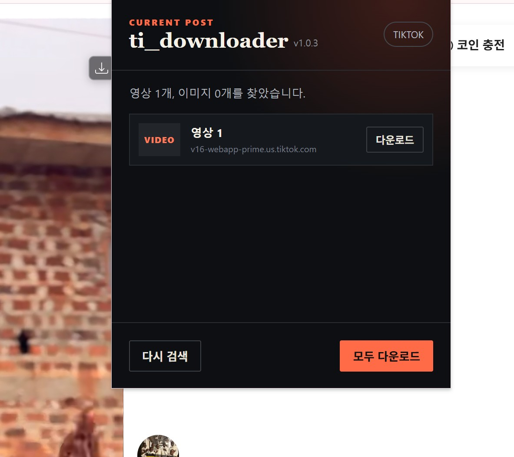

# ti_downloader

현재 열린 Instagram 또는 TikTok 게시물에서 감지한 영상과 이미지를 다운로드하는 Manifest V3 Chrome 확장.

## 설치

1. Chrome에서 `chrome://extensions`를 연다.
2. 우측 상단의 개발자 모드를 켠다.
3. `압축해제된 확장 프로그램을 로드합니다`를 누른다.
4. 이 디렉터리를 선택한다.
5. 기존에 열려 있던 Instagram/TikTok 탭은 한 번 새로고침한다.

## 사용

1. Instagram 게시물/Reel 또는 TikTok 영상/사진 게시물을 연다.
2. 영상은 재생하고, 캐러셀은 필요한 항목을 한 번씩 넘기면 감지율이 높아진다.
3. 확장 아이콘을 눌러 감지된 항목을 개별 또는 일괄 다운로드한다.

## 현재 범위

- Instagram progressive MP4, 이미지, 캐러셀 후보
- TikTok 재생 MP4 및 사진 게시물 이미지 후보
- 현재 페이지의 네트워크 JSON과 DOM을 함께 탐색

Instagram DASH 영상/음성 병합, HLS, ZIP 묶음은 포함하지 않는다.
